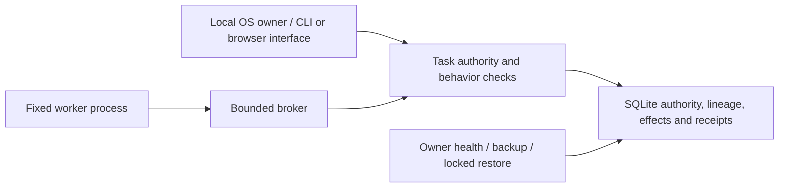

# DecisionGuard 1.1.0 — bounded offline prototype

This release completes the planned eight phases for the supported deterministic local worker. It does not claim semantic AI reasoning, arbitrary hostile-code isolation, universal injection detection, or production readiness. The 160-case synthetic evaluation remains an internal comparison; broad real permissions still allow harmful use.

## Deploy without downloads

Requires Python 3.11–3.14 on Linux/macOS, or WSL's Linux filesystem. No runtime pip packages, external services, API keys, Node server or model files. Python/SQLite are supplied by the operator, not vendored. Source and custom UI are MIT; no third-party UI assets. Optional setuptools metadata is inherited for developers, but the supported release path below uses only the standard library and needs no build backend.

Normal users start with `python3 start.py` and the browser guide in README.md. The commands below verify the release bundle from `phase-eight`:

```sh
python3 scripts/build_release.py --output local/decisionguard-v1.zip
python3 -m zipfile -e local/decisionguard-v1.zip local/unpacked
cd local/unpacked/decisionguard-v1
python3 run.py --help
python3 -W error::ResourceWarning -m unittest discover -s tests -v
python3 scripts/worker_walkthrough.py --input README.md --workspace local/demo
python3 evals/run.py --output local/evaluation
```

Use your own UTF-8 input for real work. README.md is simply a public text input for the smoke exercise. The zip uses an explicit reviewed file list, fixed metadata and SHA256SUMS.json; two builds from identical source produce identical bytes. Hashes detect accidental changes, not malicious replacement of both content and hashes. The package includes tests, docs, license and browser UI. Local databases, user inputs and Python installations are excluded.

## Health, backup, restore and restart

```sh
python3 scripts/operations.py health local/demo/state.sqlite3
python3 scripts/operations.py backup local/demo/state.sqlite3 local/backups/demo.sqlite3
python3 scripts/operations.py restore local/backups/demo.sqlite3 local/recovered/state.sqlite3
python3 scripts/operations.py health local/recovered/state.sqlite3
python3 run.py --db local/recovered/state.sqlite3 overview
```

Health checks SQLite integrity, foreign keys, schema and owner, without creating a missing store. Running records mean recovery review is required; they are not proof a process is alive. Health does not prove sufficient free disk, policy correctness or detector accuracy. Commands print structured JSON; failures return 2. Keep stdout/stderr in a private log directory if needed. Identifiers, paths and owner reasons may be sensitive. No external telemetry or OpenTelemetry exporter is enabled.

Backup uses SQLite's snapshot API, including committed WAL pages. Destinations must be new and are mode 0600. Interrupted/invalid snapshots are removed; a hard process kill can leave a partial destination, which must be checked before use. Keep parent directories private. Backups contain original documents and authority; they are not encrypted. Use an encrypted local volume if required. Same-UID owner code is trusted.

**Stop all brokers and consoles before operational restore.** Restore creates a separate database; it never replaces the live database. Every grant is revoked, every existing context/node quarantined, queued work cancelled, running records stopped, and a restore event appended. Receipts, notes, budgets and profiles from the backup are preserved. Later events/receipts absent from that backup cannot be recovered by this tool. Do not run original and restored copies as competing authorities. Retire the old copy, compare retained receipts, then explicitly approve current scope and use `start-fresh-worker` for new work. Restoring never replays a run. Old IDs remain reserved.

Schema 4 remains compatible with phases five–seven. There is no schema change to migrate in v1. Versions 1–3 and unknown versions are rejected; reimport user files and recreate approvals in a fresh store. No downgrade or UID rewriting is provided.

## Bounded retention procedure

Do not delete individual events, receipts, inputs or graph edges from a live store. They support authority, reconciliation and containment. This release intentionally provides no automatic row pruning. Operate one bounded experiment per store; review disk usage using health's byte count (also account for SQLite sidecars and backups). Close each experiment, verify a backup and restore drill, then archive or delete the **whole closed workspace** according to your retention policy. A practical local cap is the last five closed exercise workspaces/backups; keep incident evidence longer if needed. Never apply that example automatically to required records. This is operator-enforced retention, not a hard disk quota. Continuous-service quotas/pruning remain outside this bounded release.

## Architecture and Python integration



`run.py --help` lists the command interface; see README for managed setup. From Python, add `src` to the import path and use `Store.initialize(Path(...))`, `Engine(path)`, and the typed `Scope`, `Permission`, `Action` contracts. `Engine` is an owner-level API, **not a worker endpoint**; `run_worker(engine, context_id, run_id, plan)` routes fixed workers through the broker. See `scripts/worker_walkthrough.py` for a complete executable integration and `docs/WORKERS.md` for plan/protocol details. No stable public HTTP SDK is promised; console routes are internal owner tooling.

## Release notes and limits

New: reproducible source archive, integrity/owner health check, consistent backup, restore with disabled authority, recovery tests, CI extraction checks and this runbook. Inherited: 135 phase-seven tests, all CLI enforcement/learning/containment/worker controls, built-in UI and frozen evaluation. Previous phase folders are unchanged. The current UI adds guided setup and plain-language results; see UI_VERIFICATION.md for the new browser checks.

Release verification includes the full tests, full evaluation, fresh extracted-source execution, recovery drill, source/private-data scan and license review. See PHASE_REPORT.md for recorded results. This is a source release and reproducible local demo, not an installer or hosted deployment. Local reasoning models, external benchmark comparisons, encrypted backup management and service-scale operations require separate future scope.
